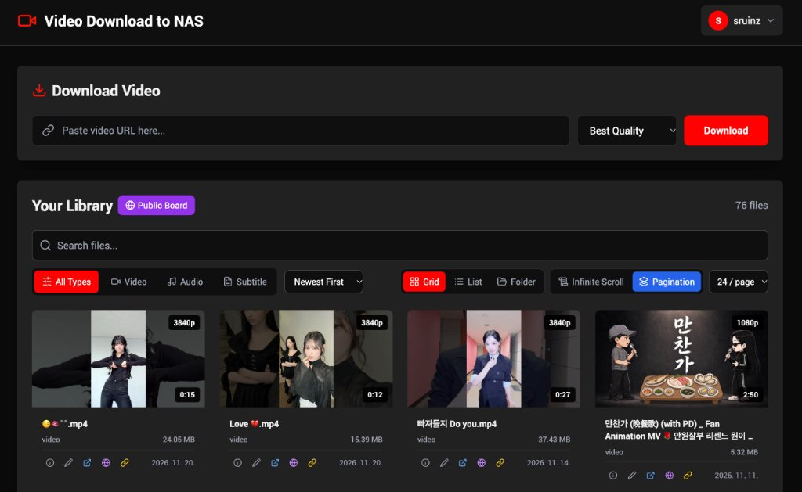

# Video Download to NAS

**한국어** | [English](./README.md)





셀프 호스팅 미디어 아카이빙 도구. 아름다운 다크 테마 UI 제공. [Video Download to NAS Extension](https://github.com/sruinz/Video-Download-to-NAS-Extension)과 호환됩니다.

> **참고**: 이것은 개인 사용을 위해 유지 관리되는 개인 프로젝트입니다. 풀 리퀘스트는 적극적으로 검토되지 않습니다. 기능을 추가하려면 포크하세요.

## 1.1.13-1 변경사항

- 모바일 리스트 뷰에서 긴 파일명이 라이브러리 영역을 화면 폭 밖으로 밀어내어 검색창·필터 바가 잘리고 각 항목 하단 액션 버튼이 화면 밖으로 이탈하던 가로 넘침 버그를 수정했습니다.
- 모바일 리스트 뷰에서 파일명 말줄임, 별도 메타데이터 줄, 왼쪽 정렬 액션 버튼으로 가독성과 조작성을 개선하고 필터 바·공개 게시판·폴더 뷰에서도 모바일 가로 넘침을 차단했습니다.

## 1.1.13 변경사항

- `영상 정보` 모달에 편집 가능한 통합 **`메모 / 설명`** 영역을 추가했습니다 (URL 자동 링크 클릭, 긴 글 접기/펼치기, 원클릭 복사, 파일명+메모 동시 검색 지원).
- `계정 설정 → 저장 설정` 탭(기존 `폴더 구성` 탭 확장)에 **`다운로드 시 영상 설명 자동 저장`** 토글(기본 OFF)을 추가해 웹 UI·브라우저 확장 프로그램·텔레그램 봇 다운로드 시 `yt-dlp` 표준 설명 메타데이터를 자동 보관하고 자유롭게 편집할 수 있습니다.
- 메모/설명이 있는 항목은 별도 아이콘을 추가하지 않고 카드·리스트의 **`i` 정보 버튼 색상만 시안(`cyan`)으로 은은하게 강조**합니다.

## 1.1.12 변경사항

- 592p 등 저해상도 영상이나 21:9·10:9 등 비표준 비율 영상에서 발생하던 **전체화면 상하좌우 4방향 레터박스 버그**를 수정하여 원본 비율을 유지하면서 화면에 꽉 차게 확대되도록 개선했습니다.
- **웹 플레이어 자막 재생** 기능을 추가했습니다 (실시간 SRT→WebVTT 변환 스트리밍, 하단 `CC` 자막 트랙 선택 메뉴, `C` 키 토글, 글자 크기·글꼴·글자 색상·배경 투명도·자막 위치 커스터마이징).
- 계정 설정에 전용 **`자막 설정` 탭**을 추가하여 웹 UI·브라우저 확장 프로그램·텔레그램 봇에 공통 적용되는 **영상+자막 자동 동시 다운로드**(다중 언어 선택, SRT/VTT 형식, 자동 생성 자막 포함)와 플레이어 자막 표시 설정을 한곳에서 관리할 수 있습니다.
- 라이브러리 자막 표시를 깔끔하게 정리했습니다: `모든 유형`에서는 독립 자막 항목을 숨기고 `자막` 탭에서만 전용 자막 카드(`SRT · KO`, 실제 파일 크기)로 표시하며, 자막이 연결된 비디오 카드·리스트에는 **`CC`** 뱃지를 표시합니다.

## 1.1.11 변경사항

- 내 라이브러리와 공개 게시판에 **그리드뷰 · 리스트뷰(분류 헤더 정렬 지원) · 폴더뷰(실제 NAS 경로 / 월별 / 사이트별 / 작성자별)** 전환 기능을 추가했으며, 모든 뷰에서 기존 파일 액션(재생, 다운로드, 이름 변경, 상세정보, 원본 링크, 공유 링크, 공개 게시판 등록/해제, 삭제)을 그대로 사용할 수 있습니다.
- **무한 스크롤**과 **페이지네이션**(12/24/48/96개씩 표시) 탐색 모드를 자유롭게 선택할 수 있으며 선택한 설정은 자동 저장됩니다.
- 미디어 플레이어에 **반복 재생(전체 반복 / 1개 반복)** 및 **랜덤(셔플) 재생** 기능을 추가하고 공개 게시판에서도 플레이리스트 연속 재생을 지원합니다.
- 푸터와 계정 설정 모달에 **커피 후원(Buy Me a Coffee)** 링크를 추가했습니다.

## 1.1.10 변경사항

- 확장 프로그램 또는 외부 API를 통한 다운로드 시 URL이나 비디오 ID가 파일명으로 전달되어 최종 저장 파일명이 왜곡되던 문제를 수정했습니다.
- 백엔드 출력 파일명 유효성 검사를 강화하여, 부적절한 요청 파일명이 들어오더라도 yt-dlp가 추출한 실제 동영상 제목을 최우선으로 보존하도록 개선했습니다.

## 1.1.9 변경사항

- 일부 다운로드 원본이 반환한 소수점 동영상 길이 때문에 라이브러리 전체를 불러오지 못하던 문제를 수정했습니다.
- 서버가 길이를 정수 초로 저장하고, 시작 시 기존 문제 레코드를 자동 보정합니다. 파일 재다운로드나 라이브러리 동기화는 필요하지 않습니다.

## 1.1.8-2 변경사항

- 로컬 로그인을 끈 경우 최고 관리자 백업 로그인을 내부 IP 직접 HTTP 접속에서만 허용합니다.
- 역방향 프록시에서는 관리자 로그인 버튼을 숨기고 로그인·REST API의 비밀번호 인증을 차단합니다. SSO와 API 토큰 인증은 유지합니다.
- 자세한 내용: [관리자 백업 로그인 안내](server/LOCAL_LOGIN_RECOVERY.ko.md)

## 1.1.8-1 변경사항

- 비회원 접근과 다운로드를 허용한 공유 링크에서 한글·Unicode·공백·특수문자가 포함된 파일명이 RFC 호환 `Content-Disposition`으로 정상 다운로드되도록 수정

## 1.1.8 변경사항

- 역할별 다운로드 요청 제한을 적용하고, 사용자별 제한은 역할 기본값보다 우선 적용
- 서버가 다운로드 요청을 순차적으로 실행하도록 변경
- 요청 제한 HTTP 429 응답의 대기 시간을 확인해 재시도할 수 있도록 응답 헤더 제공
- 원본 서버가 HTTP 429를 반환하면 30초 또는 60초 지연 후 서버가 자동으로 재시도
- 요청별 작업 파일을 격리하고 한 요청의 다중 결과 파일을 모두 보존

## ⚠️ 법적 고지

**이 소프트웨어는 개인 미디어 아카이빙 및 백업 목적의 도구입니다.**

### 사용자 책임
- **귀하**가 다운로드할 콘텐츠를 선택합니다
- **귀하**가 저작권법 준수에 책임이 있습니다
- **귀하**가 플랫폼 이용약관을 존중해야 합니다
- 개발자는 귀하의 도구 사용에 대해 **책임지지 않습니다**

### 합법적 사용 사례
✅ 본인이 업로드한 콘텐츠 백업  
✅ 크리에이티브 커먼즈 라이선스 콘텐츠 다운로드  
✅ 퍼블릭 도메인 자료 아카이빙  
✅ 교육적 공정 이용 목적  
✅ 합법적으로 구매한 콘텐츠의 개인 백업  

### 금지된 사용
❌ 허가 없이 저작권 콘텐츠 다운로드  
❌ 다운로드한 콘텐츠의 상업적 재배포  
❌ 플랫폼 이용약관 위반  
❌ 상업적 목적의 대량 다운로드  

**이 소프트웨어를 사용함으로써, 귀하는 모든 관련 법률 및 이용약관을 이해하고 준수할 것임을 인정합니다.**

## ✨ 주요 기능

- 🎥 **비디오 다운로드** - 1000개 이상의 사이트 지원 (yt-dlp 기반)
- 🎵 **오디오 추출** - M4A 또는 MP3 형식
- 📝 **자막 다운로드** - 다국어 지원 (SRT, VTT)
- ✏️ **파일 이름 변경** - 보안 검증 및 확장자 자동 보존
- 📊 **비디오 메타데이터 표시** - 상세 정보 확인 (해상도, 코덱, 비트레이트, 프레임레이트)
- 🎨 **아름다운 UI** - 모던 다크 테마
- 🔐 **보안 인증** - JWT 토큰 및 SSO 지원
- 📱 **반응형 디자인** - 모든 기기에서 작동
- 🔌 **확장 프로그램 호환** - 브라우저 확장과 연동
- 🐳 **Docker 지원** - Docker Compose로 간편한 배포

## 🚀 빠른 시작

### 사전 요구사항

- Docker & Docker Compose
- NAS 네트워크 접근

### 설치

1. **프로젝트 디렉토리 생성**
   ```bash
   cd Video-Download-to-NAS
   ```

2. **환경 변수 설정**
   ```bash
   cp .env.example .env
   # .env 파일을 편집하여 설정을 변경하세요!
   ```

3. **서비스 시작**
   ```bash
   docker-compose up -d
   ```

4. **웹 인터페이스 접속**
   ```
   http://your-nas-ip:3000
   ```

   **첫 사용자 설정:**
   - 첫 번째로 가입하는 사용자가 자동으로 슈퍼 관리자가 됩니다
   - 강력한 사용자명과 비밀번호를 선택하세요
   - 이 계정은 전체 시스템 접근 권한을 갖습니다

## 📦 시놀로지 NAS 배포

1. DSM에서 **Docker** 앱 열기
2. **레지스트리**에서 `python`과 `node` 검색 및 다운로드
3. **File Station**에서 폴더 생성: `/docker/video-download-to-nas`
4. 프로젝트 파일을 이 폴더에 업로드
5. **터미널** (SSH)을 열고 실행:
   ```bash
   cd /volume1/docker/video-download-to-nas
   sudo docker-compose up -d
   ```

## 🔧 설정

### 환경 변수

`.env` 파일 편집:

```env
# 보안 (반드시 변경하세요!)
JWT_SECRET=your-super-secret-jwt-key-change-me
SSO_ENCRYPTION_KEY=your-sso-encryption-key-if-using-sso
ALLOWED_ORIGINS=*
```

### 다운로드 위치

기본적으로 다운로드는 `./downloads`에 저장됩니다. `docker-compose.yml`에서 변경 가능:

```yaml
volumes:
  - /path/to/your/nas/folder:/app/downloads
```

## 🔌 브라우저 확장 프로그램 설정

이 서버는 [Video Download to NAS Extension](https://github.com/sruinz/Video-Download-to-NAS-Extension)과 호환됩니다.

### 방법 1: Config URL (가장 쉬움 - 권장)

1. Chrome/Edge 스토어에서 확장 프로그램 설치
2. 웹 UI에 로그인
3. **계정 설정** > **API 토큰** 탭으로 이동
4. **"새 토큰 생성"** 클릭
5. **"방법 1: Config URL"** 복사
6. 확장 프로그램 옵션을 열고 Config URL 붙여넣기
7. 저장

### 방법 2: 사용자명 + API 토큰

1. API 토큰 생성 (위 2-4단계)
2. **"방법 2: API 토큰"** 복사
3. 확장 프로그램 옵션 설정:
   - **인증 방법**: 사용자명 + API 토큰
   - **REST API URL**: `http://your-nas-ip:8000/rest`
   - **사용자명**: 귀하의 사용자명
   - **API 토큰**: 토큰 붙여넣기

### 방법 3: 사용자명 + 비밀번호 (레거시)

1. 확장 프로그램 옵션 열기
2. 설정:
   - **인증 방법**: 사용자명 + 비밀번호
   - **REST API URL**: `http://your-nas-ip:8000/rest`
   - **사용자명**: 귀하의 사용자명
   - **비밀번호**: 귀하의 비밀번호

**참고:** 방법 1과 2가 더 안전하며, 특히 SSO 사용자에게 권장됩니다.

## 🔑 API 토큰 인증

API 토큰은 비밀번호 없이 외부 애플리케이션(브라우저 확장, 텔레그램 봇)을 인증하는 안전한 방법입니다.

### 장점

- ✅ 비밀번호 인증보다 **더 안전**
- ✅ SSO 계정과 **호환** (Google, Microsoft, GitHub 등)
- ✅ **개별 관리** - 다양한 앱에 대해 여러 토큰 생성
- ✅ **쉬운 취소** - 비밀번호 변경 없이 토큰 취소
- ✅ **감사 추적** - 각 토큰의 마지막 사용 시간 확인

### API 토큰 생성

1. 웹 UI에 로그인
2. 프로필 아이콘 클릭 > **계정 설정**
3. **API 토큰** 탭으로 이동
4. **"새 토큰 생성"** 클릭
5. 설명적인 이름 입력 (예: "내 텔레그램 봇", "Chrome 확장")
6. 토큰을 즉시 복사 (다시 표시되지 않습니다!)

### 보안 모범 사례

- 🔒 가능한 경우 비밀번호 대신 **API 토큰 사용**
- 🔄 정기적으로 **토큰 교체** (3-6개월마다)
- 🗑️ 사용하지 않는 토큰 **즉시 취소**
- 📝 토큰 사용 추적을 위해 **설명적인 이름 사용**
- 🚫 공개적으로 또는 코드 저장소에 **토큰 공유 금지**
- ⚠️ 토큰을 비밀번호처럼 **비밀로 유지**!

## 📖 API 문서

### 인증

**로그인**
```http
POST /api/login
Content-Type: application/json

{
  "id": "your_username",
  "pw": "your_password"
}
```

응답:
```json
{
  "access_token": "eyJ...",
  "token_type": "bearer"
}
```

### 비디오 다운로드

**다운로드 시작 (확장 프로그램 호환)**
```http
POST /rest
Content-Type: application/json

{
  "url": "https://example.com/video/...",
  "resolution": "1080p",
  "id": "your_username",
  "pw": "your_password"
}
```

**다운로드 시작 (토큰 사용)**
```http
POST /api/download
Authorization: Bearer <token>
Content-Type: application/json

{
  "url": "https://example.com/video/...",
  "resolution": "best"
}
```

### 지원 해상도

- 비디오: `best`, `2160p`, `1440p`, `1080p`, `720p`, `480p`, `360p`, `240p`, `144p`
- 오디오: `audio-m4a`, `audio-mp3`
- 자막: `srt|ko`, `srt|en`, `srt|ja`, `vtt|ko`, `vtt|en`, `vtt|ja`

## 🛠️ 개발

### 로컬 실행

**백엔드:**
```bash
cd backend
pip install -r requirements.txt
uvicorn app.main:app --reload --host 0.0.0.0 --port 8000
```

**프론트엔드:**
```bash
cd frontend
npm install
npm run dev
```

## 📝 기술 스택

- **백엔드**: FastAPI, yt-dlp, SQLAlchemy, JWT
- **프론트엔드**: React, Vite, TailwindCSS, Lucide Icons
- **데이터베이스**: SQLite
- **컨테이너**: Docker, Nginx

## 🤝 기여

**참고**: 이것은 개인 사용을 위해 유지 관리되는 개인 프로젝트입니다. 풀 리퀘스트는 적극적으로 검토되거나 병합되지 않습니다.

기능을 추가하거나 버그를 수정하려면:
- **저장소를 포크**하여 변경하세요
- **자신의 포크를 유지 관리**하세요
- 다른 사람에게 도움이 될 수 있다면 **포크를 공유**하세요

GitHub Issues를 통한 버그 보고는 환영하며 알려진 문제를 문서화하는 데 도움이 됩니다.

## 📄 라이선스

MIT License

## 🙏 크레딧

- [yt-dlp](https://github.com/yt-dlp/yt-dlp) - 비디오 다운로드 엔진
- [FastAPI](https://fastapi.tiangolo.com/) - 모던 Python 웹 프레임워크

## ⚠️ 중요한 법적 정보

### 이것은 도구이지 서비스가 아닙니다

이 소프트웨어는 yt-dlp 기반의 **범용 미디어 다운로드 도구**입니다. 콘텐츠를 호스팅, 제공 또는 배포하지 않습니다. 사용자가 자신의 URL을 제공하고 다운로드할 내용을 선택합니다.

### 귀하의 책임

1. **저작권 준수**: 콘텐츠를 다운로드하고 저장할 권리가 있는지 확인
2. **이용약관**: 접근하는 웹사이트의 이용약관 존중
3. **개인 사용**: 이 도구는 개인적, 비상업적 사용을 위해 설계됨
4. **법률 준수**: 귀하의 관할권의 모든 관련 법률 준수

### 개발자 책임

이 소프트웨어의 개발자는:
- 저작권 침해를 지지하거나 장려하지 **않습니다**
- 사용자가 다운로드하기로 선택한 것을 통제하지 **않습니다**
- 사용자 행동이나 위반에 대해 책임지지 **않습니다**
- 이 도구를 보증 없이 "있는 그대로" 제공합니다

### 인정

이 소프트웨어를 설치하고 사용함으로써, 귀하는 다음을 인정합니다:
- 이러한 조건과 귀하의 책임을 이해합니다
- 합법적이고 정당한 목적으로만 이 도구를 사용할 것입니다
- 귀하의 행동에 대한 전적인 책임을 수락합니다
- 개발자는 오용에 대해 책임지지 않습니다

### 질문이나 우려사항?

이 도구가 오용되고 있다고 생각하거나 법적 우려사항이 있는 경우, 저장소 관리자에게 문의하세요.

---

**기억하세요**: 무언가를 다운로드할 *수* 있다고 해서 다운로드해야 *한다*는 의미는 아닙니다. 항상 크리에이터의 권리와 플랫폼 정책을 존중하세요.


---

## ☕ 후원

이 프로젝트가 도움이 되셨다면 커피 한 잔 사주세요!

<a href="https://www.buymeacoffee.com/sruinz" target="_blank"></a>
